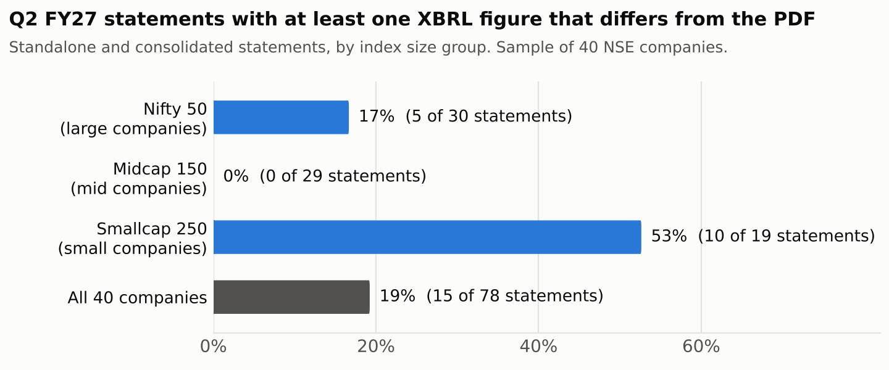
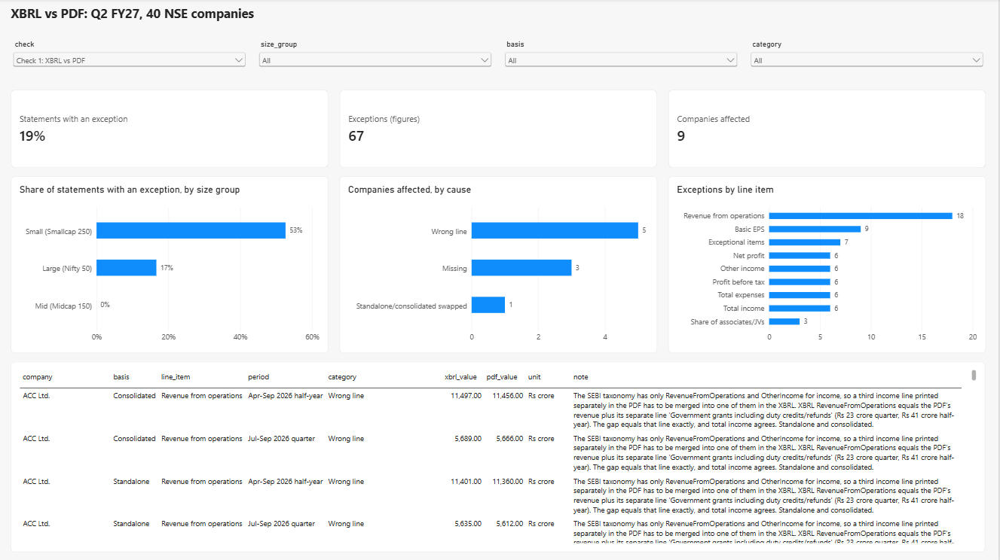
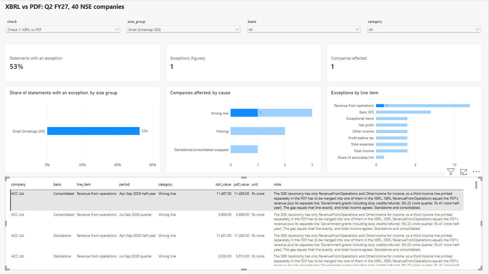

# XBRL vs PDF: how accurate is India's machine-readable results data?

Every listed company in India files its quarterly results twice: once as a PDF for people to read, and once as XBRL, a tagged format that data vendors, banks and research teams load straight into their databases. If the two don't agree, the wrong number travels quietly into every model built on that data.

I wanted to know how often that happens, so I took a random sample of 40 NSE-listed companies and checked their Q2 FY27 (July–September 2026) XBRL against their own PDFs, figure by figure. Every difference I found is traced to a cause and logged.

**The short answer: 15 of 78 results statements (19%) had at least one XBRL figure that didn't match the company's PDF.** That's 9 of the 40 companies.



The one-page summary is in [WRITEUP.md](WRITEUP.md).

## What I found

**The biggest problem is a missing quarter.** Coal India, Emami and Vedanta Power filed their Q2 XBRL as "Half Yearly", so it holds April–September figures and nothing for July–September alone. Anyone pulling the quarter from XBRL gets a blank for these three. Laurus Labs made the same mistake a year earlier and fixed it with a revision three months later.

**Some differences are built into the format.** The SEBI taxonomy has only two income lines, revenue and other income. When a company prints a third income line in its PDF (government grants at ACC, investment income at M&M, "other operating income" at Firstsource), the XBRL has to fold it into revenue. Total income still agrees, but XBRL revenue is not the revenue the company reports, and their earlier quarters' XBRL does the same.

**A few are plain tagging slips.** Welspun Living's consolidated EPS in the XBRL is the figure *before* exceptional items. Tech Mahindra tagged its share of associates as an exceptional item. Afcons' consolidated half-year EPS in the XBRL (4.59) is actually the standalone number; the PDF says 1.94.

**Earlier figures change, and the XBRL doesn't follow.** Ten companies restated last quarter's or last year's numbers in this quarter's PDF: mergers (Adani Ports, JSW Steel, Maruti), businesses sold or demerged (L&T Technology Services, Swiggy, United Spirits), regrouping (ACC, Coal India), a joint venture's accounting change (Grasim) and a bonus issue (Trent). Each is explained in the PDF, but a database that keeps the first-filed XBRL still holds the old numbers. Coal India's own reconciliation lists "previously reported" figures that match the original XBRL to the rupee.

**No scale or sign errors.** I expected crore/lakh mix-ups and flipped signs. There were none.

**By size:** 10 of 19 small-company statements had an error, 5 of 30 large and none of the 29 mid-size. With 40 companies I wouldn't read too much into that.

Every exception, with a note on what caused it, is in [`output/error_log.csv`](output/error_log.csv) (165 rows).

## Dashboard

A one-page Power BI dashboard ([`dashboard/xbrl_audit.pbix`](dashboard/xbrl_audit.pbix)) lets you filter by check, size group, basis and cause, and read the note behind each exception.



Small companies only, with one exception selected in the table:



## How it works

**Sample.** 15 companies from the Nifty 50, 15 from the Nifty Midcap 150 and 10 from the Nifty Smallcap 250, drawn at random with a fixed seed (`scripts/draw_sample.py`, `random.seed(2026)`), so anyone running the script on the same index lists gets the same companies. I left out the whole Financial Services industry, because banks, NBFCs and insurers file in a different format. I tested the method on 10 companies first, then ran all 40.

**Data.** The XBRL files and result PDFs come from NSE's own filing feeds, collected in a normal browser session (the site blocks scripted downloads). Every file's link and timestamp is in `data/download_log_*.csv`. The XBRL is in `data/raw/`. The PDF figures I extracted are in `data/pdf_extract/`, with the page number for every row.

**Three checks**, each a SQL query over one SQLite database (`data/audit.db`):

1. **XBRL vs PDF.** Nine line items (revenue, other income, total income, total expenses, share of associates, exceptional items, profit before tax, net profit, basic EPS), for the quarter and the half-year, standalone and consolidated. 1,288 comparisons.
2. **Revisions.** Where a company re-filed its XBRL: what changed, how long after, and what reason it gave. 8 revised files from 4 companies.
3. **Restatements.** Last quarter's and last year's XBRL as first filed, against the comparative columns in this quarter's PDF. 1,255 comparisons.

Each difference gets one category: rounding, wrong scale or unit, sign flipped, wrong line, standalone and consolidated swapped, missing, restated, or unexplained.

**Two things to get right before comparing anything:**

- *Rounding.* Values are compared in rupees, and a gap counts as rounding if it is within half of one printed unit of the coarser source. A PDF in crores to two decimals allows ₹50,000.
- *Profit before tax.* The XBRL taxonomy adds the share of associates and joint ventures *after* tax, but 24 of the 39 consolidated PDFs put it *above* profit before tax. For those, the check adds it back before comparing. That's a difference in definition, not an error.

**Checking the extraction.** Before any comparison, every extracted PDF statement has to pass two sums: revenue plus other income equals total income, and income minus expenses (with associates and exceptional items) equals profit before tax. All 78 pass.

## How I used AI

I used Claude, an AI assistant, to draft the Python and SQL and to read the results tables out of the PDFs. I didn't take its output on trust:

- Of the 2,596 values extracted from PDFs, 2,076 equal an XBRL figure, which is an independent source.
- The other 520 got a second read and then my own check by eye against the PDF ([`output/eye_check_list.csv`](output/eye_check_list.csv), [`output/eye_check_list_full.csv`](output/eye_check_list_full.csv)). Neither found anything to correct.
- Seven slips from the first, automatic extraction pass were caught and fixed: six by the XBRL comparison and one on re-reading the page (a value cut short, a shifted column, EPS taken from the wrong line). The arithmetic checks can't catch slips below profit before tax, which is why every unconfirmed value was checked by eye.
- The AI also suggested a cause for each exception. I checked each one against the raw XBRL and the PDF.

## Limits

- 40 companies and one quarter. The findings describe this sample.
- NSE copies only; I didn't compare BSE copies of the same filings.
- Gallantt Ispat's PDF has no standalone statement, so its standalone XBRL isn't checked. Vedanta Power and VISL were listed after demergers and have no year-ago filing.
- A difference between two published versions of a figure is a data-quality finding. It doesn't mean any company did anything wrong.

## Running it yourself

You need Python 3 with `lxml` and `matplotlib` (`pip install -r requirements.txt`). From the repository root:

```
python scripts/parse_xbrl.py            # XBRL files -> data/xbrl_figures.csv
python scripts/check_pdf_arithmetic.py  # the two sums for every PDF statement
python scripts/load.py                  # builds data/audit.db
python scripts/run_check1.py            # check 1
python scripts/run_check2.py            # check 2, every fact in the XML files
python scripts/run_check2_sql.py        # check 2, the SQL version
python scripts/run_check3.py            # check 3
python scripts/build_error_log.py       # output/error_log.csv
python scripts/build_eye_check_list.py
python scripts/make_charts.py
python scripts/build_dashboard_data.py  # tables behind the dashboard
```

```
sql/        schema.sql and the three checks
scripts/    the steps above, plus draw_sample.py
data/       sample, index lists, download logs, tag map, raw XBRL, PDF extracts, audit.db
output/     results of each check, error_log.csv, the eye-check lists, charts
dashboard/  Power BI file, screenshots and the two tables it reads
```
