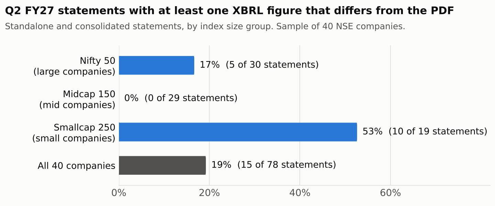

# How accurate is India's machine-readable results data?

**In this sample of 40 NSE-listed companies, 19% of Q2 FY27 results statements (15 of 78) had at least one XBRL figure that did not match the company's own PDF.**

Data firms and banks load the XBRL version of quarterly results straight into their databases, so a gap between the XBRL and the PDF reaches every analyst who uses that data. I compared 2,543 figures for 40 randomly drawn non-financial companies (15 Nifty 50, 15 Midcap 150, 10 Smallcap 250): 9 line items, quarter and half-year, standalone and consolidated. Every gap was traced to one cause.

## Errors by category

| Category | Check 1: Q2 FY27 XBRL vs PDF | Check 3: earlier XBRL vs this quarter's PDF |
|---|---|---|
| Missing | 50 values (3 companies) | 15 values (1 company) |
| Wrong line | 16 values (5 companies) | 13 values (5 companies) |
| Standalone and consolidated swapped | 1 value (1 company) | – |
| Restated, reason given in the PDF | – | 69 values (10 companies) |
| Unexplained | – | 1 value (1 company) |
| Wrong scale or unit, sign flipped | none found | none found |
| **Total** | **67 of 1,288 compared** | **98 of 1,255 compared** |

No scale or sign errors turned up. The XBRL stores every value in full rupees, and that held for all 40 companies.

## Three worked examples

**1. The quarter is missing (Coal India, consolidated).** The PDF reports Jul–Sep revenue of ₹44,178.74 crore. The XBRL has no quarter figure at all, because it was filed with reporting type "Half Yearly" and carries only April–September (₹90,433.54 crore, which matches the PDF). Three companies did this in Q2 FY27, 6 of 79 files. A database that reads the quarter from the XBRL gets nothing for them.

**2. The taxonomy has no line for it (Mahindra & Mahindra, standalone).** The PDF shows revenue from operations of ₹42,477.42 crore and, on a separate line, ₹1,804.46 crore of income from investments in subsidiaries, associates and joint ventures. The XBRL revenue is ₹44,281.88 crore, the sum of the two. The SEBI taxonomy has only two income lines, revenue and other income, so a third printed line has to be folded into one of them. Total income agrees. Three of the five "wrong line" companies show this pattern, and their earlier quarters' XBRL does the same.

**3. A standalone figure in the consolidated filing (Afcons).** The consolidated PDF shows half-year basic EPS of ₹1.94 (profit ₹71.39 crore). The consolidated XBRL shows ₹4.59, which is the standalone half-year EPS. The consolidated profit in the XBRL is correct; only the EPS differs.

## Revisions and restatements

**Revisions (check 2).** Four companies filed 8 revised XBRL files. Three revised within 20 minutes with no stated reason, and none of their figures changed. One revised 92 days later to fix a "Half Yearly" filing, the same mistake as example 1. Of all the errors found in this sample, only that one had been corrected by a revision, three months after filing.

**Restatements (check 3).** Ten companies changed last quarter's or last year's figures in this quarter's PDF, each with a reason: mergers (3), businesses sold or demerged (3), regrouping (2), a joint venture's accounting change and a bonus issue. Coal India's reconciliation lists "previously reported" figures that equal the first-filed XBRL exactly. These are legitimate changes, but a database that stores the first-filed XBRL and never reloads it holds the old figures.

## Limits

- 40 companies, one quarter. Small companies had the highest rate (10 of 19 statements), mid-size the lowest (0 of 29), but the sample is too small to say this holds in general.
- Financial-services companies are excluded because they file in a different format.
- Every finding describes a difference between two published versions of a figure. Nothing here says that any company acted wrongly.
- Only NSE copies were checked; whether BSE copies are identical was not tested.

## How AI was used and how each value was checked

An AI tool (Claude) drafted the scripts and SQL and read the results tables from the PDFs into CSV files with page numbers. Every extracted statement passes two arithmetic checks (income and profit before tax add up). Of 2,596 extracted values, 2,076 equal an XBRL figure, an independent source. The other 520 each got a second read and then my check by eye. The AI tool also proposed a category and note for each exception; each one was checked against the raw XBRL and the PDF. All three checks are SQL queries over one SQLite database, and the repository rebuilds every number from the raw files.
